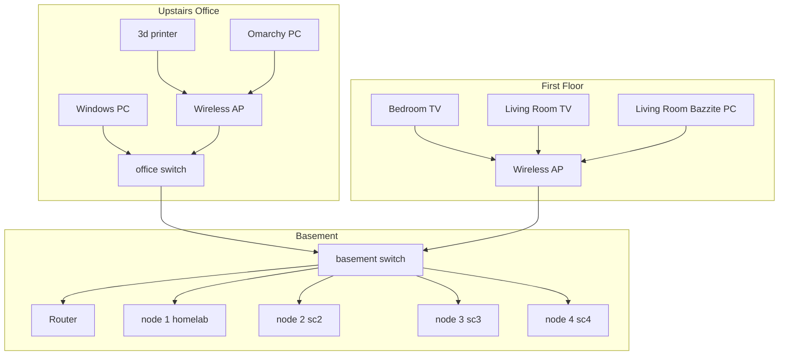

# HomeLab

A 4-node Proxmox VE cluster (`homelab`, `sc2`, `sc3`, `sc4`) running media, photos, DNS, notes sync, a dashboard, and monitoring. Remote access is Tailscale-only (no router port forwards, no inbound ports). This repo documents its architecture, configs (secrets removed) and operations, including real incident postmortems.

> IPs below use placeholders (`<LAN>.x`). Real secrets never live in this repo; see `.env.example`.

## Architecture

Physical rooms and every guest live in the React Flow map under [`diagram/`](diagram/) (`npm install && npm run dev`). Summary:

## Services

| Service | Where | Purpose |
|---|---|---|
| Proxmox VE | 4-node cluster | Hypervisor. Every node also runs node_exporter |
| VM 100 minecraftserver | node 1 `homelab` | Minecraft server (4 cores, 10 GB RAM) |
| LXC 112 monitor | node 1 `homelab` | Prometheus, Alertmanager (Discord alerts), Grafana, Uptime Kuma, pve-exporter (2c, 2 GB RAM, 16 GB disk) |
| LXC 101 immich | node 2 `sc2` | Photo library (4c, 8 GB RAM, 125 GB disk) |
| LXC 102 jellyfin | node 3 `sc3` | Media streaming (2c, 2 GB RAM, 30 GB disk). `/srv/media` was removed |
| LXC 103 pihole | node 4 `sc4` | DNS filtering. LAN DHCP cutover is still on the roadmap |
| LXC 104 arr | node 4 `sc4` | arr stack |
| LXC 105 obsidian-sync | node 4 `sc4` | Notes sync |
| LXC 106 homepage | node 4 `sc4` | Service dashboard |
| LXC 107 monitoring | node 4 `sc4` | Jellystat and a legacy Uptime Kuma |
| LXC 108 torrent | node 4 `sc4` | Torrent client |
| LXC 109 rustdesk | node 4 `sc4` | Remote desktop |
| LXC 110 prowlarr | node 4 `sc4` | Indexer manager |
| LXC 111 docker | node 4 `sc4` | FlareSolverr |
| Tailscale | off-cluster path | Remote access only. No router port forwards |

## Hardware

Three Skull Canyon-class NUCs (NUC6i7KYK / i7-6770HQ; node 2 is that class) and one NUC7i5BNK. Each has 32 GB RAM and a 250 GB disk.

| Node | Name | IP | Model | CPU | RAM | Storage |
|---|---|---|---|---|---|---|
| 1 | homelab | <LAN>.10 | Intel NUC6i7KYK | i7-6770HQ | 32 GB | Samsung 970 EVO Plus 250 GB NVMe |
| 2 | sc2 | <LAN>.11 | NUC6i7KYK class | i7-6770HQ | 32 GB | Samsung 960 EVO 250 GB NVMe |
| 3 | sc3 | <LAN>.12 | Intel NUC6i7KYK | i7-6770HQ | 32 GB | Samsung 970 EVO Plus 250 GB NVMe |
| 4 | sc4 | <LAN>.9 | Intel NUC7i5BNK | i5-7260U | 32 GB | Transcend 250 GB SATA SSD |

## By the numbers

| Metric | Value |
|---|---|
| Proxmox nodes | 4, one cluster |
| Hardware | 3x NUC6i7KYK-class + 1x NUC7i5BNK, 128 GB RAM, 4x 250 GB disks |
| Guests | 1 VM + 12 LXCs |
| Thin pool reclaimed on node 3 (`sc3`) | 95.77% → 4.46% (137G pool) |
| Postmortems published | 1 |
| Uptime | TODO |
| Total CPU / RAM / storage | 3x i7-6770HQ + 1x i5-7260U, 128 GB RAM, 4x 250 GB disks |

More: [architecture](docs/architecture.md) · [monitoring](docs/monitoring.md) · [blog](blog/) · [changelog](CHANGELOG.md)

## Skills demonstrated

- **Virtualization & clustering:** Proxmox VE cluster management, quorum, LXC containers, LVM-thin storage.
- **Linux administration:** systemd boot troubleshooting, emergency mode recovery, fstab, LVM, ext4 fsck.
- **Networking:** LAN design, Pi-hole on LXC 103 (node 4; LAN DNS cutover planned), mesh VPN (Tailscale), NFS.
- **Self-hosting:** Jellyfin, Immich, the arr stack, Homepage, Obsidian sync, monitoring.
- **Incident response:** console-level diagnosis and written postmortems ([node 3 thin pool](incidents/2026-11-node4-thin-pool.md)).
- **Security hygiene:** secrets kept out of git, gitleaks pre-commit, GitHub secret scanning + push protection.

## Incidents

- [2026-11 — node 3 (`sc3`) unreachable: LVM thin pool overcommitted](incidents/2026-11-node4-thin-pool.md)

## Roadmap

- [ ] Cut over LAN DNS to Pi-hole (LXC 103 on node 4)
- [ ] Build a DIY NAS (barebones PC + bulk hard drives) and move media to it
- [x] Monitoring stack on node 1 LXC 112 (Prometheus, Grafana, Alertmanager to Discord, Uptime Kuma, pve-exporter). LXC 107 on node 4 still has Jellystat and a legacy Uptime Kuma
- [ ] Backups (TODO: Proxmox Backup Server?)
