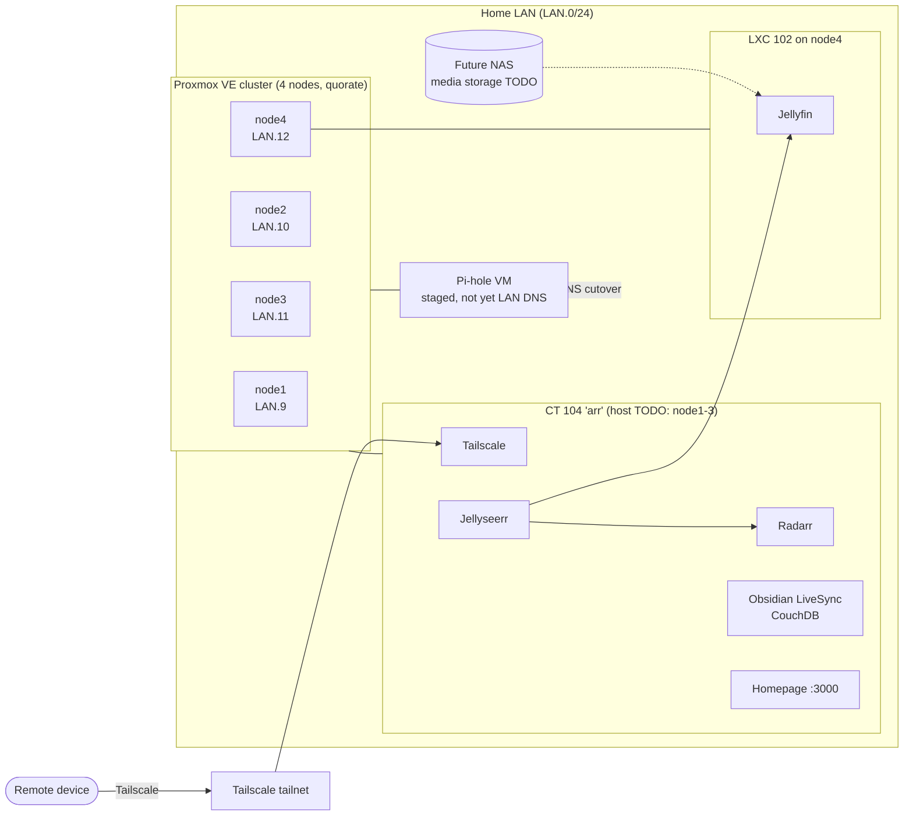

# HomeLab

A 4-node Proxmox VE cluster running self-hosted media, a staged Pi-hole DNS filter, notes sync and a service dashboard, reachable remotely only over Tailscale (no router port forwards, no inbound ports). This repo documents its architecture, configs (secrets removed) and operations, including real incident postmortems.

> IPs below use placeholders (`<LAN>.x`). Real secrets never live in this repo; see `.env.example`.

## Architecture

## Services

| Service | Where | Purpose | Port |
|---|---|---|---|
| Proxmox VE | 4-node cluster | Hypervisor, LXC/VM hosting | 8006 |
| Pi-hole | VM (TODO: node) | DNS filtering, staged; not yet the LAN's DNS server | TODO |
| Tailscale | CT 104 + TODO | Zero-config remote access (WireGuard) | n/a |
| Homepage | CT 104 (TODO: node1-3) | Service dashboard | 3000 |
| Jellyseerr | CT 104 (TODO: node1-3) | Media requests | TODO |
| Radarr | CT 104 (TODO: node1-3) | Movie library automation | TODO |
| Obsidian LiveSync (CouchDB) | CT 104 (TODO: node1-3) | Self-hosted notes sync | TODO |
| Jellyfin | LXC 102 (node4) | Media streaming | TODO |

## Hardware

The cluster runs on four Intel NUCs: **3x Intel NUC "Skull Canyon"** and **1x standard Intel NUC**.

| Node | IP | Model | CPU | RAM | Storage |
|---|---|---|---|---|---|
| node1 | <LAN>.9 | TODO: Skull Canyon NUC or standard NUC | TODO | TODO | TODO |
| node2 | <LAN>.10 | TODO: Skull Canyon NUC or standard NUC | TODO | TODO | TODO |
| node3 | <LAN>.11 | TODO: Skull Canyon NUC or standard NUC | TODO | TODO | TODO |
| node4 | <LAN>.12 | TODO: Skull Canyon NUC or standard NUC | TODO | TODO | LVM-thin `pve/data` 137G |

TODO: map which node is which NUC, and fill in CPU/RAM per node.

## By the numbers

| Metric | Value |
|---|---|
| Proxmox nodes | 4 (quorate) |
| Hardware | 3x Skull Canyon NUC + 1x standard Intel NUC |
| Self-hosted services | 8+ (Proxmox, Pi-hole, Tailscale, Homepage, Jellyseerr, Radarr, CouchDB/LiveSync, Jellyfin) |
| Thin pool reclaimed in node4 incident | 95.77% → 4.46% (137G pool) |
| Postmortems published | 1 |
| Uptime | TODO |
| Total CPU / RAM / storage | TODO |

More: [architecture](docs/architecture.md) · [monitoring](docs/monitoring.md) · [blog](blog/) · [changelog](CHANGELOG.md)

## Skills demonstrated

- **Virtualization & clustering:** Proxmox VE cluster management, quorum, LXC containers, LVM-thin storage.
- **Linux administration:** systemd boot troubleshooting, emergency mode recovery, fstab, LVM, ext4 fsck.
- **Networking:** LAN design, Pi-hole DNS filtering (staged in a VM, cutover planned), mesh VPN (Tailscale), NFS.
- **Self-hosting:** media stack (Jellyfin, Jellyseerr, Radarr), CouchDB, dashboards.
- **Incident response:** console-level diagnosis and written postmortems ([node4 thin pool](incidents/2026-11-node4-thin-pool.md)).
- **Security hygiene:** secrets kept out of git, gitleaks pre-commit, GitHub secret scanning + push protection.

## Incidents

- [2026-11 — node4 unreachable: LVM thin pool overcommitted](incidents/2026-11-node4-thin-pool.md)

## Roadmap

- [ ] Cut over LAN DNS to Pi-hole
- [ ] Build a DIY NAS (barebones PC + bulk hard drives) and move media to it
- [ ] Deploy the monitoring stack (Prometheus/Grafana/Alertmanager), with alerts to Discord
- [ ] Backups (TODO: Proxmox Backup Server?)
