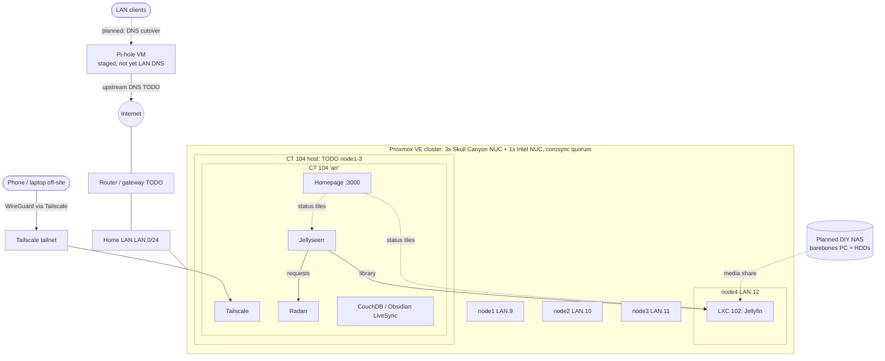

# Architecture

All addresses are placeholders (`<LAN>.x`). Unknowns are marked TODO.

## Node to service map
| Node | IP | Workloads |
|---|---|---|
| node1 | <LAN>.9 | TODO |
| node2 | <LAN>.10 | TODO |
| node3 | <LAN>.11 | TODO |
| node4 | <LAN>.12 | LXC 102 Jellyfin |
| TODO (one of node1-3) | - | CT 104 'arr': Homepage, Jellyseerr, Radarr, CouchDB, Tailscale |

## Flows
- **DNS:** Pi-hole is deployed in a VM (TODO: which node) but is not yet the LAN's DNS server. Planned: point the router's DHCP DNS at Pi-hole (upstream TODO).
- **Remote access:** Tailscale only. No router ports are forwarded; there are no inbound ports from the internet.
- **Media:** Jellyseerr → Radarr → library → Jellyfin. Media storage will move to a planned DIY NAS.

## Hardware
3x Intel NUC "Skull Canyon" + 1x standard Intel NUC. TODO: map nodes to hardware.
