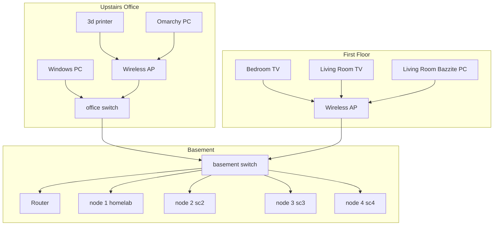

# Architecture

All addresses are placeholders (`<LAN>.x`). Proxmox inventory below was verified 2026-11-03.

The physical map (rooms, switches, access points, clients, and the four nodes with their VMs and LXCs) is the React Flow diagram in [`diagram/`](../diagram/). Run it with `npm install && npm run dev` from that directory. `npm run check-layout` fails if any room, host, or guest boxes overlap.

## Cluster

One Proxmox VE cluster. Every node runs `node_exporter` on the host.

| Node | Name | IP | Model | CPU | RAM | Storage |
|---|---|---|---|---|---|---|
| 1 | homelab | <LAN>.10 | Intel NUC6i7KYK | i7-6770HQ | 32 GB | Samsung 970 EVO Plus 250 GB NVMe |
| 2 | sc2 | <LAN>.11 | NUC6i7KYK class | i7-6770HQ | 32 GB | Samsung 960 EVO 250 GB NVMe |
| 3 | sc3 | <LAN>.12 | Intel NUC6i7KYK | i7-6770HQ | 32 GB | Samsung 970 EVO Plus 250 GB NVMe |
| 4 | sc4 | <LAN>.9 | Intel NUC7i5BNK | i5-7260U | 32 GB | Transcend 250 GB SATA SSD |

Three machines are Skull Canyon class (NUC6i7KYK / i7-6770HQ; node 2 is that class, the exact kit label was not re-checked). Node 4 is the NUC7i5BNK.

### Guests

| Node | Guest | Resources | What runs |
|---|---|---|---|
| 1 homelab | VM 100 minecraftserver | 4 cores, 10 GB RAM | Minecraft server |
| 1 homelab | LXC 112 monitor | 2c, 2 GB RAM, 16 GB disk | Prometheus, Alertmanager (Discord alerts), Grafana, Uptime Kuma, pve-exporter |
| 2 sc2 | LXC 101 immich | 4c, 8 GB RAM, 125 GB disk | Immich |
| 3 sc3 | LXC 102 jellyfin | 2c, 2 GB RAM, 30 GB disk | Jellyfin. The `/srv/media` movie disk was removed; media will move to a NAS later. |
| 4 sc4 | LXC 103 pihole | | Pi-hole |
| 4 sc4 | LXC 104 arr | | arr stack |
| 4 sc4 | LXC 105 obsidian-sync | | Obsidian sync |
| 4 sc4 | LXC 106 homepage | | Homepage |
| 4 sc4 | LXC 107 monitoring | | Jellystat and a legacy Uptime Kuma |
| 4 sc4 | LXC 108 torrent | | torrent client |
| 4 sc4 | LXC 109 rustdesk | | RustDesk |
| 4 sc4 | LXC 110 prowlarr | | Prowlarr |
| 4 sc4 | LXC 111 docker | | FlareSolverr |

## Flows

- **DNS:** Pi-hole is LXC 103 on node 4 (`sc4`). Pointing the router's DHCP DNS at it is still on the roadmap.
- **Remote access:** Tailscale only. No router ports are forwarded; there are no inbound ports from the internet.
- **Media:** Jellyfin is LXC 102 on node 3 (`sc3`). The local movie disk is gone. A DIY NAS (barebones PC and bulk disks) will hold media later.
- **Photos:** Immich is LXC 101 on node 2 (`sc2`).
- **Monitoring:** the current stack is LXC 112 on node 1 (`homelab`). Node 4 LXC 107 still runs Jellystat and a legacy Uptime Kuma.
